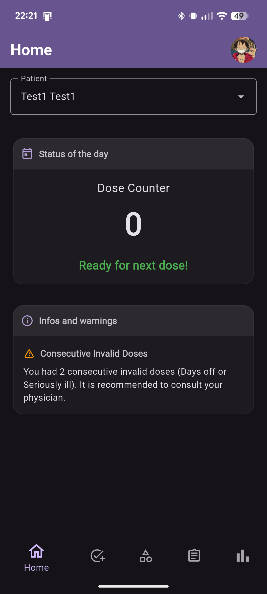
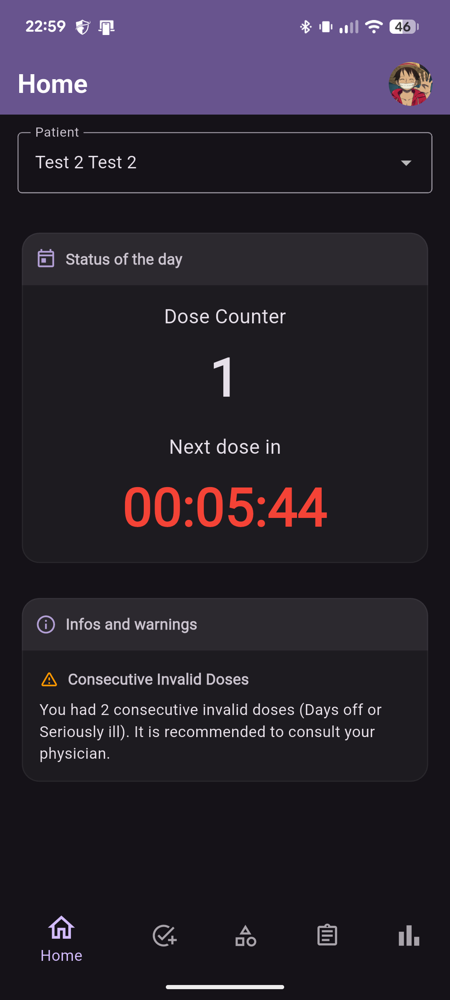
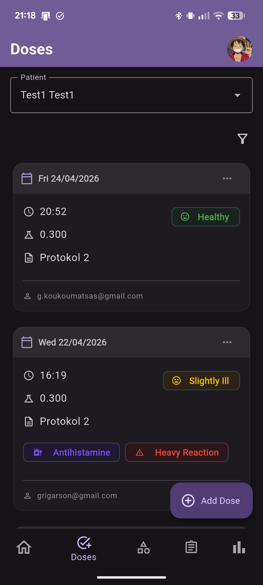
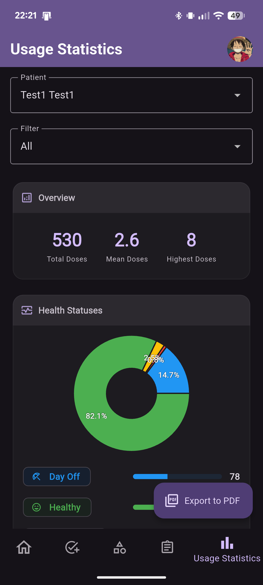

# Allergy Scheduler

A production-ready Flutter and Firebase application for meticulous tracking of allergen administration and dosage history.

## 🚀 Overview

Allergy Scheduler is designed for patients on active medical protocols who need to track precise dosages, health status, and reactions in real-time. It provides healthcare providers and patients with a unified view of historical data through denormalized tables and professionally generated PDF reports.

### ✨ Key Features

- **Real-time Tracking**: Log doses with health, medication, and reaction statuses.
- **Sequential Worker Queue**: High-consistency backend processing for dosage groups and statistics.
- **Smart Analytics**: Aggregated usage statistics (yearly, monthly, daily) with interactive charts.
- **Automated Scheduling**: end-of-day "Day Off" dose creation and smart countdown notifications for next allowed dose.
- **Multi-user Access**: RBAC membership system allowing doctors and caregivers to view patient data.
- **Premium Reporting**: Professional PDF exports for dosage history and usage stats (M3 Design).
- **Cross-Platform**: Full support for Android, iOS, macOS, Windows, and Web.

## 📱 Screenshots

  
  
  
  

### 🛠️ Tech Stack

- **Frontend**: Flutter (Provider, Equatable, json_serializable)
- **Backend**: Firebase Cloud Functions (TypeScript), Firestore, FCM, Auth
- **Infrastructure**: Firebase Local Emulator Suite for local development
- **Subscription**: RevenueCat for multi-platform premium entitlement management
- **CI/CD**: GitHub Actions for automated testing, deployment, and project management

---

## 🚀 Development Tracks

The project features a streamlined, multi-stage workflow directly integrated into VS Code:

| Track | Goal | Trigger |
| :--- | :--- | :--- |
| **Debug** | Rapid Iteration | `[Frontend] Serve app (Debug)` |
| **Testing** | Firebase App Distribution | `[Frontend] Build and Deploy (Internal Testing)` |
| **Production** | Google Play / Web Release | `[Project] Build and Deploy (Production)` |
| **Git Hygiene** | Pre-commit Cleanup | `[Project] Prepare project` |

For a deep dive into these tracks and the monorepo architecture, see **[documentation/overview.md](documentation/overview.md)**.

---

## 📚 Documentation

Each app folder has a human-readable `documentation/overview.md` and an AI agent rulebook `AGENTS.md`:

- 🏛️ **[documentation/overview.md](documentation/overview.md)**: Top-level project overview, installation, development tracks, and links to:
  - **[frontend/documentation/overview.md](frontend/documentation/overview.md)** & **[frontend/AGENTS.md](frontend/AGENTS.md)** (Flutter frontend)
  - **[backend/documentation/overview.md](backend/documentation/overview.md)** & **[backend/AGENTS.md](backend/AGENTS.md)** (Firebase Cloud Functions & Firestore)
  - **[ai_tooling/documentation/overview.md](ai_tooling/documentation/overview.md)** & **[ai_tooling/AGENTS.md](ai_tooling/AGENTS.md)** (AI agent tooling: skills, permissions, MCP servers)
- 👁️ **[AGENTS.md](AGENTS.md)**: Root AI agent instructions: permissions, the agent setup version check, and the rules for every change.
- 📖 **[USER_MANUAL.md](USER_MANUAL.md)**: End-user guide for patients and staff. Features, subscription tiers, and app flows.
- 🛡️ **[PRIVACY_POLICY.md](PRIVACY_POLICY.md)**: Details on data collection, usage, and your rights.
- 🏪 **[STORE_LISTING.md](STORE_LISTING.md)**: Optimized metadata and assets for the Google Play Console store presence.

---
*Maintained by the Allergy Scheduler Team.*
